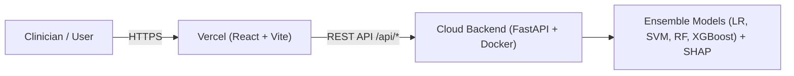

# Adaptive Clinical Decision Support System (CDSS) - Deployment Guide

This guide explains how to deploy the full **Adaptive Clinical Decision Support System** to production using **Vercel** (for the React Frontend) and a **Cloud API Host** (like Render or Railway for the FastAPI Backend).

---

## Architecture Overview

---

## Part 1: Deploy Backend (FastAPI + Models) to Render

Since the backend runs machine learning models (scikit-learn, XGBoost, SHAP), deploy it to **Render.com** (free tier supported):

1. **Sign in to Render**:
   - Go to [render.com](https://render.com) and log in with your GitHub account (`sankari-1203`).
2. **Create New Web Service**:
   - Click **New +** -> **Web Service**.
   - Select your repository: `sankari-1203/adaptive-clinical-decision-support`.
3. **Configure the Service**:
   - **Name**: `cdss-backend` (or your choice)
   - **Region**: Choose the closest region (e.g., Singapore, Frankfurt, Oregon)
   - **Environment**: `Docker` (Render automatically detects the repository's `Dockerfile`)
   - **Plan**: `Free`
4. **Deploy**:
   - Click **Create Web Service**.
   - Wait 2–3 minutes for the Docker container to build and start.
   - Once deployed, copy your backend URL:
     `https://cdss-backend.onrender.com`
   - Test it in your browser: `https://cdss-backend.onrender.com/api/health` (should return `{"status":"healthy",...}`).

---

## Part 2: Deploy Frontend to Vercel

1. **Sign in to Vercel**:
   - Go to [vercel.com](https://vercel.com) and log in with GitHub.
2. **Import Repository**:
   - Click **Add New...** -> **Project**.
   - Select `sankari-1203/adaptive-clinical-decision-support`.
3. **Configure Project Settings**:
   - **Framework Preset**: `Vite` (automatically detected).
   - **Root Directory**: Click *Edit* and select **`frontend`**.
   - **Build Command**: `npm run build`
   - **Output Directory**: `dist`
4. **Set Environment Variable**:
   - Expand **Environment Variables**.
   - Add:
     - **Name**: `VITE_API_BASE`
     - **Value**: Your backend URL from Part 1 (e.g. `https://cdss-backend.onrender.com` without trailing slash).
5. **Deploy**:
   - Click **Deploy**.
   - Vercel will build and deploy the React application in ~30 seconds.
   - You will receive a live URL: `https://adaptive-clinical-decision-support.vercel.app`.

---

## Local Development vs. Production

| Environment | Frontend URL | Backend URL | Variable |
|---|---|---|---|
| **Local** | `http://localhost:3000` | `http://localhost:8000` | `VITE_API_BASE=http://localhost:8000` |
| **Production** | `https://your-app.vercel.app` | `https://your-backend.onrender.com` | `VITE_API_BASE=https://your-backend.onrender.com` |
